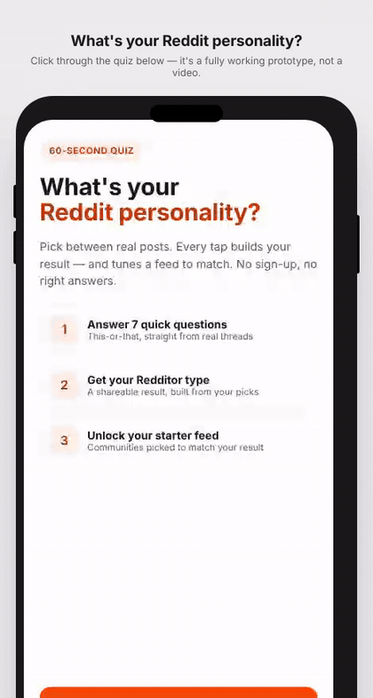

# Vibe Check: Quiz-Based Onboarding for Reddit

**A product concept and working prototype that tackles Reddit's new-user cold start problem with a 60-second "this or that" quiz built from real posts.**

### [▶ Try the live prototype](https://sunaynab.github.io/reddit-vibe-check/)


> Unofficial concept by an independent product candidate. Not affiliated with or endorsed by Reddit. Community names are used for illustration, and all posts in the prototype are made up.

---

## The problem

Reddit's value lives in its long tail of niche communities, but a brand-new user doesn't know those communities exist. With no history to learn from, the recommender falls back to popular content, which is the least personal part of Reddit. Many new users leave before they find a community that feels like theirs.

Today's onboarding asks new users to pick interests from a list of topics. That's quick, but it has gaps:

- **Labels are vague.** "Gaming" or "Science" each cover thousands of communities with very different tones.
- **It misses the voice.** People choose Reddit for its humor, honesty and depth. A topic grid captures none of that.
- **It ignores intent.** Many people arrive from a search with a specific job to do, like researching a purchase or getting advice.
- **There's no payoff.** Picking topics feels like a form, so people skip it or pick at random.

## The solution

Vibe Check replaces the topic picker with a short game. Every answer teaches the recommender something, and every screen shows the user real Reddit-style content.

| Step | What the user does | What the recommender learns |
| --- | --- | --- |
| 1. Arrival | Comes from an app install or a Google search | Search arrivals get their first round seeded from the thread they landed on |
| 2. Intent | Answers "What brought you to Reddit today?" | Utility seekers get a shorter, focused path |
| 3. This or That | Picks which of two posts they'd open first (4–6 rounds) | Community affinity, both positive and negative |
| 4. Humor check | Picks the post that made them laugh | Tone preference: wholesome, chaotic, nerdy or deadpan |
| 5. Result | Gets a persona (e.g. "Deadpan Tinkerer") and a starter pack of communities | One-tap joins, the strongest signal of all |
| 6. First feed | Sees a tuned feed with week-one quests | Upvotes, saves and comments take over from quiz answers |

### Design principles

1. **Every answer is a post.** Users choose between real posts, not abstract labels, so each pick maps straight to a community.
2. **Intent before interests.** Knowing why someone came changes what they need first.
3. **Capture voice, not just topics.** A humor round tunes the tone of the feed.
4. **Under 90 seconds, always skippable.** Skipping still gives a reasonable default feed.
5. **A payoff worth finishing.** A fun persona and a ready-made starter pack.
6. **The game continues in week one.** Starter quests guide people to their first join, upvote and comment.

## Prototype features

- **Full clickable flow** from welcome screen to a personalized feed
- **Arrival toggle** to compare a direct install with a search arrival
- **Model view panel** that shows interest weights update live after every tap, so you can see exactly how the quiz feeds the recommender
- **Starter pack** with one-tap join and unjoin
- **Week-one quests** that unlock trophies as you upvote, save, join and comment
- **Opt-in sharing** that shares only the persona name, never the username or communities
- **Skip path** that falls back to a popular feed with a prompt to tune it later
- **Exploration slot** in the feed to avoid locking users into their early answers
- Light and dark themes, keyboard accessible, works on mobile

## How I'd measure success

The goal is retention, not quiz completion. A fun quiz that leads to a bad feed is a failure.

| Type | Metric |
| --- | --- |
| North star | Day-7 retention of new users |
| Leading indicator | Communities joined in the first session |
| Input | Time to first meaningful action (upvote, join, comment, save) |
| Input | Quiz completion rate and drop-off by round |
| Guardrail | Onboarding abandonment |
| Guardrail | Day-30 retention, to rule out a novelty bump |
| Guardrail | Hides and "show fewer" in week one |

**Experiment:** an A/B test of today's onboarding vs. the quiz MVP vs. the quiz without the humor round, randomized at signup and read out by arrival source.

## Risks and how the design handles them

| Risk | Mitigation |
| --- | --- |
| Anonymity is core to Reddit | Sharing is opt-in and shows only the persona name |
| Sensitive interests (health, politics, NSFW, identity) | Never used in quiz pairs or result cards |
| Quiz fatigue | Capped at about 90 seconds, with progress shown and skip always available |
| People pick what sounds good, not what they'll use | Quiz answers are a starting guess that fades as real behavior comes in |
| Lurkers dislike gamification | Quests are optional and never push users to post |
| Filter bubbles | The feed keeps an exploration slot outside the user's top interests |

## MVP vs. later

| Feature | Phase |
| --- | --- |
| Intent question, This or That rounds, humor round | MVP |
| Starter pack with one-tap join | MVP |
| Skip path with popular fallback | MVP |
| Referrer-seeded first round | V2 |
| Persona card with opt-in sharing | V2 |
| Week-one quests and trophies | V2 |
| In-feed "tune your feed" cards | Later |
| ML-chosen pairs that pick the most informative next question | Later |

## Tech

A single self-contained `index.html` with vanilla JavaScript and CSS. No build step and no dependencies apart from Google Fonts.

### Run it locally

```bash
git clone https://github.com/sunaynab/reddit-vibe-check.git
cd reddit-vibe-check
open index.html   # or double-click the file
```

## About

Built by **Sunayna Bhikha**, an ML engineer and technical product lead with 8 years in engineering, 5 of them in AI/ML. This project shows how I approach a product problem: understand the user, design for the data the system needs, and measure what actually matters.

Feedback is welcome. Open an issue or reach out on [LinkedIn](https://www.linkedin.com/in/sunaynabhikha).
